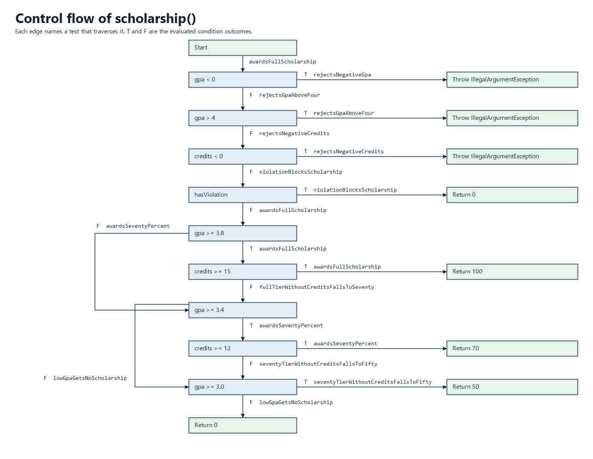

# Лаборатори 9 — JaCoCo кодын хамралт

**Д.Бүрэнтөгс · B222270092**

```text
> java -version
openjdk version "17.0.21.1" 2026-11-17 LTS
OpenJDK Runtime Environment Microsoft-16059596 (build 17.0.21.1+2-LTS)
OpenJDK 64-Bit Server VM Microsoft-16059596 (build 17.0.21.1+2-LTS, mixed mode, sharing)

> mvn -version
Apache Maven 3.9.11 (3e54c93a704957b63ee3494413a2b544fd3d825b)
Maven home: <workspace>/work/java\apache-maven-3.9.11
Java version: 17.0.21.1, vendor: Microsoft, runtime: <workspace>/work/java\jdk-17.0.21.1+2
Default locale: en_US, platform encoding: Cp1252
OS name: "windows 11", version: "10.0", arch: "amd64", family: "windows"
```

Локал замыг `<workspace>` гэж товчилсон. `mvn verify` командаар тест болон JaCoCo тайлан гарна. HTML тайлан `target/site/jacoco/index.html` дотор үүснэ.

## A. Эхний хамралт

Таван тест гүйцэтгэхэд мөрийн хамралт **64% (16/25)**, салааны хамралт **53.66% (22/41)** байв. Нийлмэл нөхцөлүүдээс онооны хязгаар, GPA массивын шалгалт, тэтгэлгийн кредитийн зарим нөхцөл зөвхөн нэг талаараа ажилласан тул шар тэмдэгтэй байв. Буруу оролтын exception, бага голчийн 0 хувийн буцаалт болон GPA-ийн C, D онооны тооцооллын мөрүүдэд хүрээгүй.

[Мавены гаралт](results/mvn-verify-A.txt) · [JaCoCo CSV](results/jacoco-A.csv)

## B. Салааны хамралт ба CFG

17 тестээр **41/41 салаа, 25/25 мөр** хамарсан. CSV дахь `BRANCH_MISSED` ба `LINE_MISSED` хоёул 0. Диаграммын T болон F ирмэгийн хажууд түүнийг дайрсан тестийн методын нэрийг тавьсан.



[Мавены гаралт](results/mvn-verify-B.txt) · [JaCoCo CSV](results/jacoco-B.csv)

## C. Давталтын зааг

- 0 удаа — `rejectsEmptyGpaArray` хоосон массив, `rejectsNullGpaArray` null утгад `IllegalArgumentException` шалгана.
- 1 удаа — `averagesASingleGrade` нь [95] → 4.0 гэж шалгана.
- 2+ удаа — `averagesFourGrades` нь [95, 85, 75, 65] → 2.5 гэж шалгана.

B шатанд хоосон болон null оролт, олон утгатай давталтын салаанууд аль хэдийн хамрагдсан. Нэг болон дөрвөн утгын нэмэлт тест нь давталтын өөр уртад дүнгийн нийлбэрийг зөв тоонд хувааж байгаа эсэхийг шалгана.

## D. 60 онооны заагийн алдаа

`exactlySixtyIsD` тест `expected: <D> but was: <F>` гэж [унасан](results/mvn-test-D-fail.txt). `2b3d9c8` commit-д `score > 60` нөхцөлийг `score >= 60` болгож зассан. Эцсийн гүйлтэд **26 тест** амжилттай болж, мөрийн ба салааны хамралт **100%** хэвээр байв.

[Эцсийн Maven гаралт](results/mvn-verify-final.txt) · [Эцсийн JaCoCo CSV](results/jacoco-final.csv)

Салааны хамралт 100% болсон ч яг 60 оноог өгөх хүртэл алдаа илрээгүй. Хоёр оператор хоёулаа үнэн ба худал гэсэн ижил хоёр салааг үүсгэнэ. Жишээ нь 62 ба 42 оноо хоёр салаагаар явдаг ч операторын ялгааг харуулдаггүй. Хамралт ямар код ажилласныг хэмждэг, харин оролт бүрд хариу зөв эсэхийг хэмждэггүй. Зааг дээрх хүлээгдсэн `D` утгыг шалгаснаар алдааг илрүүлж, засварыг баталгаажуулсан.

Codex-ийг тестийн хүрээ боловсруулах, Maven гүйлтийн үр дүнг хадгалах, CFG болон тайланг бэлтгэхэд ашиглав.
